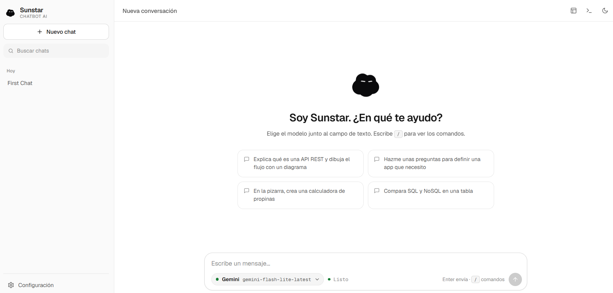

# Sunstar · ChatBot AI

Un chat de IA que corre en tu propio equipo. Conecta con **Claude, ChatGPT, Gemini, DeepSeek, Grok, Qwen, Mistral, Groq, OpenRouter y Ollama**, responde en tiempo real y puede dibujar diagramas, hacerte cuestionarios interactivos y construir mini-aplicaciones en una pizarra.

- Tus chats y tus API keys se quedan en tu navegador.
- El servidor es solo un puente local (Express) que reenvía las peticiones al proveedor.
- Sin base de datos, sin cuentas y sin dependencias de frontend que compilar.



---

## Contenido

- [Inicio rápido](#inicio-rápido)
- [Qué puede hacer](#qué-puede-hacer)
- [Proveedores](#proveedores)
- [Comandos](#comandos)
- [Formato enriquecido](#formato-enriquecido)
- [Diagramas Mermaid](#diagramas-mermaid)
- [Cuestionarios interactivos](#cuestionarios-interactivos)
- [Pizarra](#pizarra)
- [Seguridad y privacidad](#seguridad-y-privacidad)
- [Configuración del servidor](#configuración-del-servidor)
- [Estructura del proyecto](#estructura-del-proyecto)
- [Pruebas](#pruebas)
- [Solución de problemas](#solución-de-problemas)
- [Mejoras futuras](#mejoras-futuras)

---

## Inicio rápido

Requisitos: **Node.js 18 o superior** y una API key de cualquiera de los proveedores (o Ollama instalado, que no necesita key).

```bash
npm install
npm start
```

Abre **http://localhost:3000**.

1. Pulsa la tuerca (abajo a la izquierda) → **Seguridad** y pega tu API key. Se verifica sola.
2. Elige el modelo en el chat, en el selector que está junto al campo de texto.
3. Escribe y presiona **Enter** (Shift+Enter para salto de línea).

Para desarrollo con recarga automática: `npm run dev`.

---

## Qué puede hacer

| Función | Descripción |
|---|---|
| **Multi-proveedor** | 10 proveedores. Cambias de modelo desde el propio chat; la lista de modelos se carga de tu cuenta al verificar la key. |
| **Chats persistentes** | Se guardan en el navegador, con buscador, renombrar, borrar y agrupación por fecha. |
| **Streaming** | La respuesta aparece mientras se genera; puedes detenerla o regenerarla. |
| **Markdown completo** | Tablas, listas de tareas, código con resaltado y botón de copiar, LaTeX (`$...$` y `$$...$$`). |
| **Diagramas Mermaid** | Pestañas Vista / Código y pantalla completa con zoom y desplazamiento. |
| **Cuestionarios** | El modelo te hace preguntas con opciones, paso a paso, y al final decides: Sí, No u Otra cosa. |
| **Pizarra** | Un lienzo por chat donde la IA crea herramientas en HTML + CSS + JS, con historial de versiones y aislamiento de seguridad. |
| **Temas** | Claro, oscuro o el del sistema. |
| **Consola de logs** | Estilo visor de logs: verifica la key, muestra cuándo se envió el mensaje, cuánto tarda y por qué falla. |
| **Comandos `/`** | Autocompletado de comandos para casi todo. |
| **Identidad** | El asistente se presenta como **Sunstar** y, si le preguntas, te dice qué modelo usa realmente. |

---

## Proveedores

| Proveedor | Id | Dónde conseguir la key | Notas |
|---|---|---|---|
| Claude (Anthropic) | `claude` | console.anthropic.com | API propia de Anthropic |
| ChatGPT (OpenAI) | `openai` | platform.openai.com/api-keys | |
| Gemini (Google) | `gemini` | aistudio.google.com/apikey | |
| DeepSeek | `deepseek` | platform.deepseek.com/api_keys | `deepseek-reasoner` muestra en la consola que está razonando |
| Grok (xAI) | `grok` | console.x.ai | |
| Qwen (Alibaba) | `qwen` | bailian.console.alibabacloud.com | Región internacional por defecto. Para China: `QWEN_BASE=https://dashscope.aliyuncs.com/compatible-mode/v1` |
| Mistral | `mistral` | console.mistral.ai | |
| Groq | `groq` | console.groq.com/keys | Modelos abiertos con inferencia muy rápida |
| OpenRouter | `openrouter` | openrouter.ai/keys | Cientos de modelos con una sola key |
| Ollama | `ollama` | — | Modelos locales. No necesita key; debe estar en ejecución en `localhost:11434` |

Todos menos Claude y Gemini usan el formato compatible con OpenAI, así que agregar otro proveedor compatible son dos entradas: una en `public/providers.js` y otra en el objeto `COMPAT` de `server.js`.

---

## Comandos

Escribe `/` para abrir el menú (flechas, Tab para completar, Esc para cerrar).

| Comando | Descripción |
|---|---|
| `/ayuda` | Lista todos los comandos |
| `/nuevo` · `/borrar` | Chat nuevo · eliminar el chat actual |
| `/modelo [nombre]` | Muestra o cambia el modelo |
| `/proveedor [nombre]` | Muestra o cambia el proveedor |
| `/preguntas [tema]` | Sunstar te hace un cuestionario interactivo |
| `/pizarra [idea]` | Abre la pizarra o crea algo en ella |
| `/diagrama <qué dibujar>` | Pide un diagrama Mermaid |
| `/tema claro\|oscuro\|sistema` | Cambia el tema |
| `/colores on\|off` | Activa o desactiva el formato enriquecido del bot |
| `/rol [nombre]` | Aplica un rol: programador, profesor, traductor, resumidor, revisor, creativo |
| `/sistema <texto>` | Prompt de sistema propio |
| `/temperatura 0-1` | Creatividad del modelo |
| `/regenerar` · `/resumir` | Repite la última respuesta · resume el chat |
| `/tokens` | Estimación de tokens usados |
| `/exportar md\|json\|html` | Descarga la conversación |
| `/config [sección]` · `/consola` · `/verificar` | Abre la configuración · la consola · verifica la key |

Atajos: `Ctrl+K` busca chats, `Esc` cierra paneles.

Para agregar un comando basta una entrada en el arreglo `COMMANDS` de `public/commands.js`.

---

## Formato enriquecido

Con **Configuración → Apariencia → Formato enriquecido** (activo por defecto) el modelo sabe usar:

```text
:::warning Atención          ← caja destacada: info, tip, success, warning, danger, note
Contenido de la caja.
:::

{color:rojo}texto{/color}    ← texto en color: rojo, verde, azul, amarillo, naranja, morado, rosa, cyan, gris
==resaltado==                ← resaltado
```

Todo se dibuja con iconos (sin emojis) y se adapta al tema claro y oscuro.

---

## Diagramas Mermaid

Cuando el modelo responde con un bloque ` ```mermaid ` (o un bloque que empieza como un diagrama: `flowchart`, `sequenceDiagram`, `classDiagram`, `erDiagram`, `gantt`, `mindmap`...), se muestra con:

- **Vista**: el diagrama dibujado a ancho completo, sobre un lienzo punteado.
- **Código**: el texto Mermaid, para editarlo o copiarlo.
- **Pantalla completa** (icono de expandir o doble clic): arrastra para mover, rueda para hacer zoom, `+` `-` `0` desde el teclado, y descarga en SVG.

Si el código tiene un error, Sunstar muestra el motivo y cambia solo a la pestaña Código. Los diagramas se redibujan al cambiar de tema.

---

## Cuestionarios interactivos

Cuando falta información, el modelo responde con un cuestionario en lugar de una lista de preguntas en texto. Tú:

1. Eliges una opción por pregunta (o varias, si la pregunta lo permite) o escribes **Otra respuesta**. En preguntas de una sola opción avanza sola.
2. Revisas el **resumen** y puedes editar cualquier respuesta.
3. Decides: **Sí, enviar** (se manda como mensaje), **No** (se descarta) u **Otra cosa** (se envía con una nota tuya).

Para provocarlo: `/preguntas` o pídeselo ("hazme unas preguntas para definir X").

Formato que usa el modelo (bloque de código de lenguaje `preguntas`):

````text
```preguntas
{"title": "App nueva",
 "questions": [
   {"question": "¿Qué tipo de app?", "options": [{"label": "Web", "description": "Navegador"}, {"label": "Móvil"}]},
   {"question": "¿Qué funciones?", "multi": true, "options": ["Login", "Pagos", "Chat"]}
 ]}
```
````

Las respuestas se guardan en el chat y siguen ahí al recargar.

---

## Pizarra

Cada chat tiene una **pizarra**: un lienzo donde la IA construye lo que le pidas con HTML, CSS y JavaScript (una calculadora, un contador, un formulario, un juego, una visualización...).

- Ábrela con el botón de la barra superior o con `/pizarra`. Se abre sola cuando el modelo crea algo.
- Pide cambios en lenguaje natural ("hazlo más grande", "agrega un historial"). Cada cambio es una **versión nueva**; las anteriores se conservan y puedes volver a cualquiera desde el selector. El modelo siempre edita la versión que estás viendo.
- **El diseño es el de Sunstar** y no se puede cambiar: la pizarra recibe el mismo sistema de diseño (colores, tipografía, botones, campos) y sigue el tema claro/oscuro.
- Botones: ver el código, copiarlo, reiniciar, pantalla completa. Si el código falla, la pizarra muestra el error y un botón para pedirle a Sunstar que lo corrija.

### Seguridad de la pizarra

El código lo escribe un modelo, así que se trata como no confiable:

| Capa | Qué evita |
|---|---|
| `iframe sandbox="allow-scripts"` **sin** `allow-same-origin` | Leer el DOM de Sunstar, `localStorage`, cookies o tus API keys |
| CSP dentro del iframe (`connect-src 'none'`, `default-src 'none'`...) | Enviar datos a internet o cargar scripts, fuentes o imágenes externos |
| Limpieza del HTML | Se eliminan `meta`, `base`, `link`, `iframe`, `object`, `embed` y `<script src>` |
| Bloqueos en el iframe | `alert/confirm/prompt`, `window.open`, formularios y enlaces externos |
| Mensajes iframe → Sunstar | Solo `error` y `ready`, validando el origen, y siempre como texto |
| Diseño inyectado con `!important` | El código no puede redefinir el tema, el fondo ni la tipografía |

Detalles en [`docs/PIZARRA.md`](docs/PIZARRA.md), incluida la lista de clases y variables CSS disponibles.

---

## Seguridad y privacidad

- Las API keys **viajan de tu navegador al servidor local** solo para reenviarse al proveedor. El servidor no las guarda ni las registra.
- En **Configuración → Seguridad** eliges dónde guardarlas:
  - **Solo esta sesión**: se borran al cerrar la pestaña.
  - **Este dispositivo**: `localStorage` sin cifrar (cómodo).
  - **Protegidas con contraseña**: cifradas con AES-256-GCM (clave derivada con PBKDF2, 250 000 iteraciones). Se piden al abrir la app.
- El navegador solo conversa con el servidor local; CORS acepta únicamente `localhost`.
- Todo lo que devuelve el modelo se sanea con DOMPurify antes de mostrarse.
- Tus chats se guardan en `localStorage`. Borrar los datos del navegador los elimina: usa `/exportar` para respaldarlos.
- No expongas este servidor a internet tal como está: no tiene autenticación.

---

## Configuración del servidor

| Variable | Descripción |
|---|---|
| `PORT` | Puerto (por defecto 3000). `PORT=4000 npm start` |
| `ANTHROPIC_BASE`, `GEMINI_BASE` | URL base de esas APIs |
| `<ID>_BASE` (`OPENAI_BASE`, `DEEPSEEK_BASE`, `GROK_BASE`, `QWEN_BASE`, `MISTRAL_BASE`, `GROQ_BASE`, `OPENROUTER_BASE`, `OLLAMA_BASE`) | URL base de cada proveedor compatible con OpenAI. Útil para regiones, proxies o servidores propios |

---

## Estructura del proyecto

```
Sunstar-chatBot-AI/
├── server.js            Puente Express: SSE, verificación de keys, proveedores
├── package.json
├── README.md
├── docs/
│   ├── img/             Capturas de pantalla
│   ├── MEJORAS.md       Ideas y plan de mejoras (imágenes, archivos...)
│   └── PIZARRA.md       Diseño, clases CSS y seguridad de la pizarra
├── public/
│   ├── index.html
│   ├── style.css        Temas claro/oscuro y componentes
│   ├── animations.css   Micro-animaciones
│   ├── features.css     Selector de modelos, diagramas, cuestionarios y pizarra
│   ├── providers.js     Catálogo de proveedores y modelos por defecto
│   ├── registry.js      Puntos de extensión (Ext)
│   ├── theme.js         Tema claro / oscuro / sistema
│   ├── store.js         Chats persistentes y bóveda de API keys
│   ├── commands.js      Comandos "/" y roles
│   ├── diagrams.js      Mermaid
│   ├── questions.js     Cuestionarios interactivos
│   ├── whiteboard.js    Pizarra
│   ├── app.js           Aplicación principal
│   └── logo-*.svg       Logo (variantes para tema claro y oscuro)
└── test/
    ├── server.test.js   Pruebas del servidor con proveedores simulados
    └── ui/              Pruebas de interfaz en un navegador real
```

Las funciones extra (diagramas, cuestionarios, pizarra) no están cableadas en `app.js`: se enganchan con `Ext` (`registry.js`) registrando manejadores de bloques de código, hidratadores, partes del prompt de sistema y clics. Así se puede añadir una nueva sin tocar el núcleo.

---

## Pruebas

```bash
npm test          # servidor: 32 pruebas con proveedores simulados, sin gastar cuota
npm run test:ui   # interfaz: navegador real controlado con puppeteer-core
```

`test:ui` usa un navegador que ya tengas instalado (Brave, Chrome o Chromium; se detecta solo, o define `BROWSER_PATH`). Arranca su propio servidor, simula las respuestas de los modelos y comprueba, entre otras cosas, que la pizarra no pueda acceder a Sunstar. Con `UI_SHOTS=./capturas` guarda capturas de pantalla.

Prueba contra las APIs reales (opcional):

```bash
GEMINI_API_KEY=... npm test
ANTHROPIC_API_KEY=... npm test
```

---

## Solución de problemas

Abre la **consola** (icono `>_` de la barra superior o `/consola`). Muestra si la key es válida, cuándo se envió el mensaje, cuánto tardó el primer token y el motivo exacto de cualquier fallo.

| Síntoma | Causa probable |
|---|---|
| Insignia "Inválida" en una key | Key mal copiada, sin permisos o sin saldo; la consola muestra el mensaje del proveedor |
| "Respuesta vacía (SAFETY / content_filter...)" | El modelo bloqueó la respuesta; reformula o cambia de modelo |
| El modelo elegido "no está disponible" | Tu cuenta no tiene acceso a él; Sunstar elige otro de la lista real |
| Ollama no responde | Ejecútalo (`ollama serve`) y descarga un modelo (`ollama pull llama3.2`) |
| El diagrama no se dibuja | Error de sintaxis Mermaid (se muestra el motivo) o sin conexión para cargar la librería |
| Olvidé la contraseña de las keys | No se puede recuperar: usa "Continuar sin keys" y vuelve a pegarlas |

---

## Mejoras futuras

Ideas y su plan de implementación (imágenes, archivos, voz, herramientas, memoria...) en [`docs/MEJORAS.md`](docs/MEJORAS.md).
